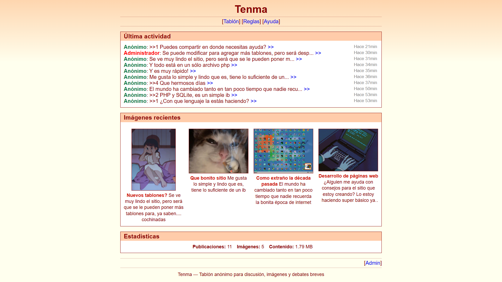
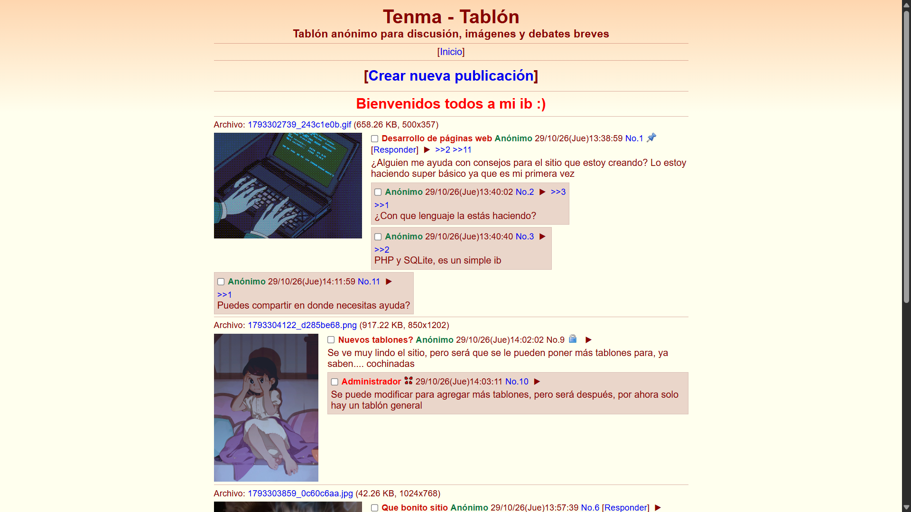
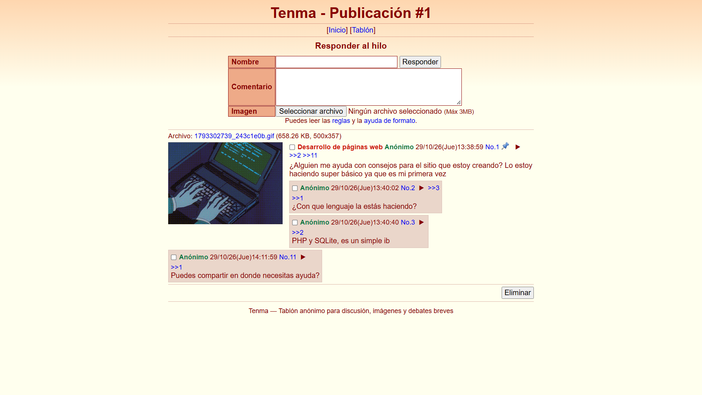
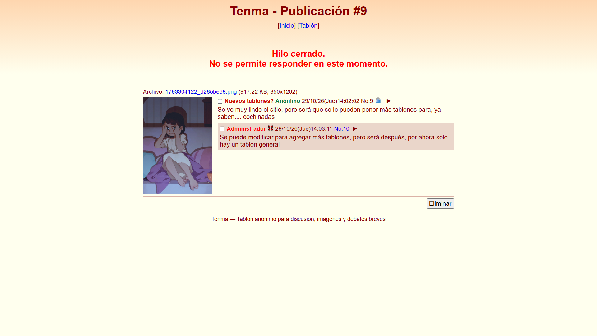
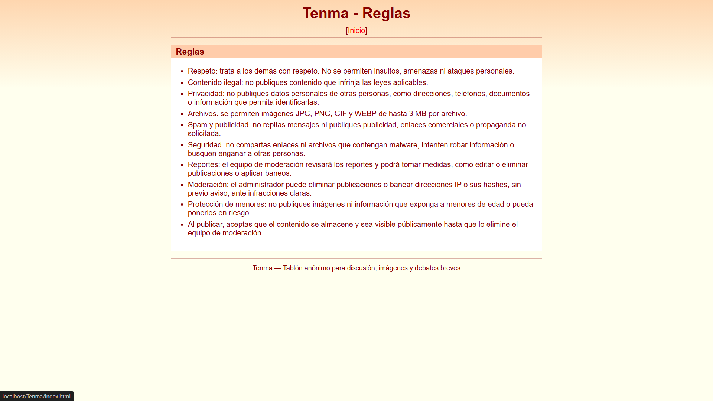
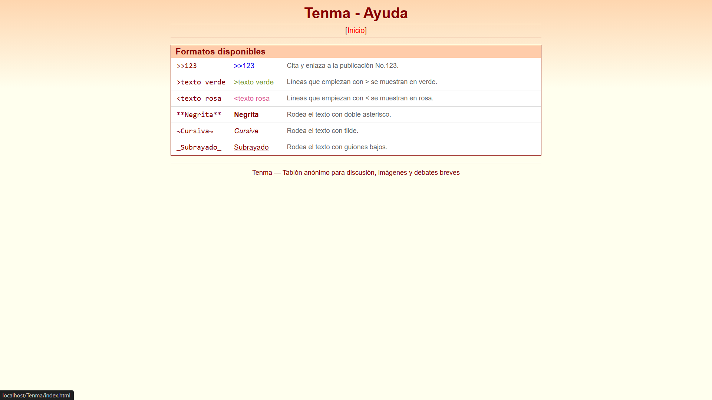
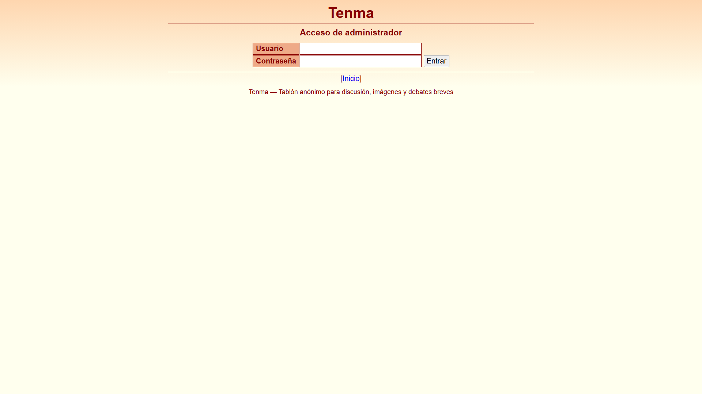
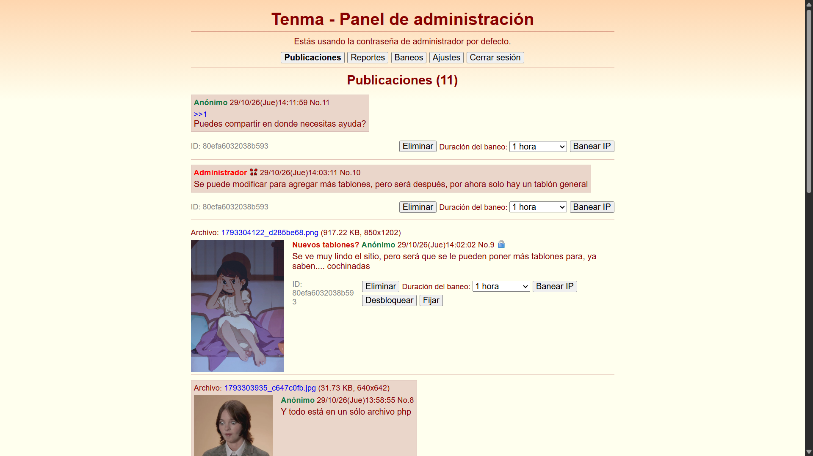
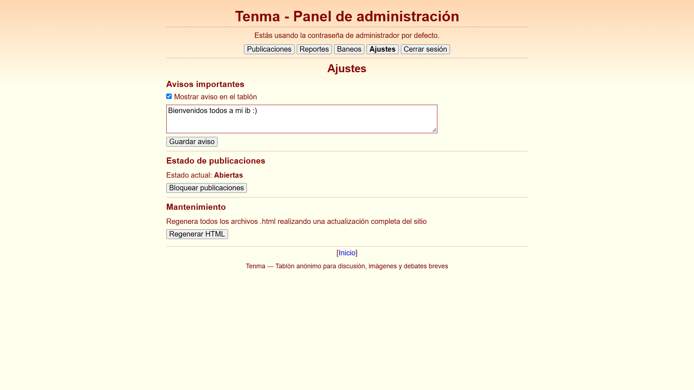

# Tenma

Tenma es un tablón anónimo de discusión inspirado en los *imageboards*. La aplicación está implementada principalmente en `index.php`, utiliza SQLite para guardar publicaciones, reportes, baneos y ajustes, y genera HTML estático para las páginas públicas. PHP sirve las páginas generadas, procesa publicaciones y reportes, y ejecuta las acciones administrativas.

## Funciones principales

- Crear hilos con imagen y responder con texto, imagen o ambos.
- Citar publicaciones con `>>123`; mostrar enlaces de vuelta a las publicaciones que las citan.
- Dar formato a comentarios: greentext (`>texto`), pinktext (`<texto`), negrita (`**texto**`), cursiva (`~texto~`) y subrayado (`_texto_`).
- Mostrar actividad reciente, imágenes y estadísticas en la página principal.
- Usar el tablón desde escritorio o móvil, ocultar publicaciones localmente en el navegador y eliminar las propias.
- Reportar contenido desde el menú de una publicación.
- Administrar reportes, publicaciones, baneos, avisos, hilos fijados o bloqueados y el estado general de las publicaciones.
- Banear por el hash asociado a una publicación durante 1 hora, 1 día, 7 días, 30 días o permanentemente.
- Generar páginas HTML, estilos, JavaScript, iconos, reglas, ayuda, sitemap y archivos de control para Apache.

El tablón no requiere cuentas: el nombre es opcional y, si se deja vacío, se usa `defaultname`. `forcedanonymity` permite ignorar los nombres ingresados. Si se inicia sesión en el panel, las publicaciones realizadas durante esa sesión aparecen identificadas como «Administrador».

## Requisitos

- PHP 7.4 o superior.
- Extensiones `pdo_sqlite` y `mbstring`.
- Apache con `mod_rewrite` y `AllowOverride` habilitado para que funcionen las rutas amigables y las reglas `.htaccess`.
- Permisos de lectura y escritura para PHP en el proyecto y sus carpetas de datos.
- Una sesión de PHP funcional para el acceso administrativo.

No se necesita Composer ni un proceso de compilación. Para recibir imágenes de hasta 3 MB, revisa también `upload_max_filesize` y `post_max_size` en la configuración de PHP: ambos deben permitir el tamaño configurado en Tenma.

## Instalación

1. Copia el proyecto en la carpeta pública del servidor; por ejemplo, en XAMPP:

   ```text
   C:\xampp\htdocs\Tenma
   ```

2. Habilita `mod_rewrite` y permite que Apache lea los archivos `.htaccess` del proyecto.
3. Asegúrate de que PHP pueda escribir en el proyecto. Tenma crea las carpetas de datos y los archivos generados al inicializarse.
4. Edita `$config` al principio de `index.php`. Como mínimo, cambia la contraseña inicial de administración antes de exponer el sitio.
5. Abre el sitio, por ejemplo, en `http://localhost/Tenma/`.

En una instalación nueva, el primer acceso prepara SQLite, crea carpetas y reglas `.htaccess` que falten, genera iconos y páginas, y redirige a `index.html`. Mantén `index.php` en la ubicación configurada: las rutas relativas de datos y recursos se resuelven desde el directorio de trabajo del sitio.

## Configuración

Los valores configurables están en el arreglo `$config` al inicio de `index.php`.


## Vista previa

Las capturas de pantalla de la aplicación se guardan en `preview/`.

| Captura | Descripción |
| --- | --- |
|  | `Página de inicio` |
|  | `Página de las publicaciones` |
|  | `Página de las respuestas` |
|  | `Página de publicaciones bloqueadas` |
|  | `Página de reglas` |
|  | `Página de ayuda` |
|  | `Página de inicio de sesión` |
|  | `Página de la administración` |
|  | `Página de ajustes` |

## Funciones no incluidas y licencia

El código de la aplicación se concentra en `index.php`; `style.css`, `tenma.js`, páginas HTML, iconos y archivos `.htaccess` son recursos generados por el programa. No hay una suite de pruebas automatizada documentada en este repositorio.